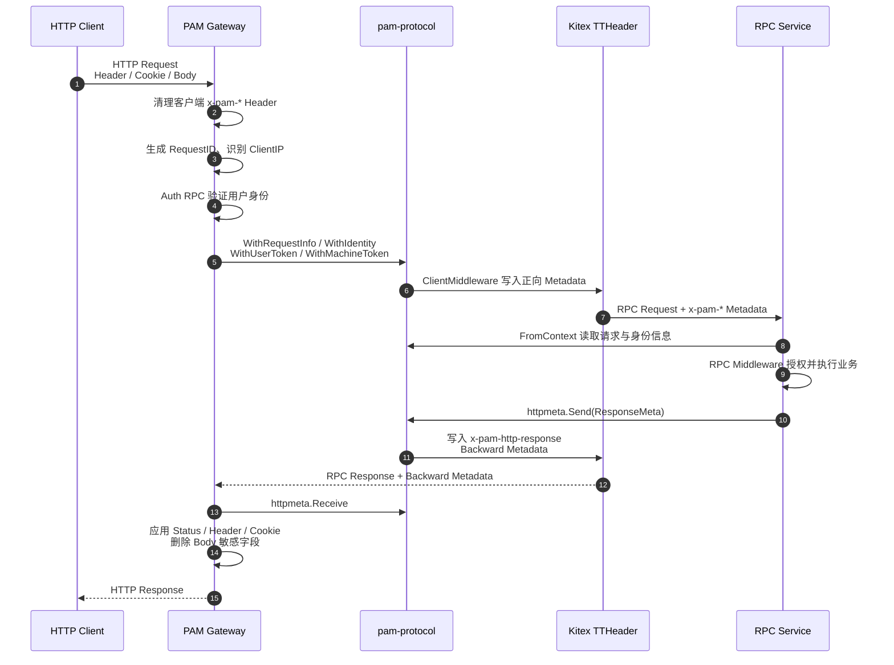

# PAM Gateway 与 RPC 双向协议

## 1. 背景

PAM Gateway 对外接收 HTTP 请求，并通过 Kitex Generic Client 调用后端
RPC 服务。Gateway 负责 HTTP、身份识别和协议转换，RPC 服务负责业务处理与
最终授权。

这条链路存在两个方向不同的问题：

1. Gateway 需要把 RequestID、客户端信息、已验证身份和受控凭证传给 RPC。
2. RPC 服务需要表达 HTTP 状态码、响应 Header、Cookie 和敏感字段删除等
   HTTP 响应要求，但 RPC 服务不应直接依赖 `net/http`。

Go 的 `context.Context` 只能在当前进程内传递，不能自动跨越 RPC 网络边界。
同时，Kitex RPC 返回值只能表达 IDL 定义的数据，不能直接操作 Gateway 的
`http.ResponseWriter`。

`pam-protocol` 为这两个问题提供共享、版本化且受约束的传输协议：

- `metadata`：处理 Gateway 到 RPC 的正向请求 Metadata。
- `httpmeta`：处理 RPC 到 Gateway 的反向 HTTP 响应 Metadata。

`pam-protocol` 只是共享 Go 模块，不是运行时服务。它不负责路由、Token
验证、角色授权、Cookie Domain 配置或 OpenTelemetry 策略。

## 2. 总体链路



两个方向的职责不同：

| 方向 | 包 | 传递内容 | 最终消费者 |
| --- | --- | --- | --- |
| Gateway → RPC | `metadata` | 请求信息、可信身份、受控凭证 | RPC Middleware 和 Handler |
| RPC → Gateway | `httpmeta` | HTTP 响应指令 | Gateway Response Adapter |

## 3. HTTP 与 Thrift 转换范围

PAM 参考 AGW/BAM 注解语义，但只承诺仓库实际使用并经过集成测试的子集。
路由层要求每个公开方法只声明一个 `api.get`、`api.post`、`api.put`、
`api.patch` 或 `api.delete`；`api.internal = "true"` 的方法不生成 HTTP
路由。

| 注解 | PAM 支持情况 | 约束 |
| --- | --- | --- |
| `api.path` / `api.query` | 支持 | 参数名必须显式声明；不做隐式来源查找 |
| `api.body` | 支持 | 按 IDL 字段转换 JSON |
| `api.form` | 支持 | 普通表单值直接转换；multipart 每个字段只允许一个文件 |
| `api.none` | 支持 | 字段不从公共 HTTP 请求读取 |
| `api.js_conv` | 支持 | 所有 ID 类 `i64` 字段必须声明为 `"true"` |
| `api.header` | 受限 | 只可能读取 Gateway 保留的安全 Header，不支持任意 Header 透传 |
| `api.cookie` | 不支持 | 浏览器 Cookie 在 Generic RPC 前被移除 |
| `api.raw_body` | 不支持 | Kitex v0.16.3 DynamicGo 对任意 raw body/response 的行为不可靠 |
| `api.http_code` | 支持 | IDL 响应可设置基础状态；`ResponseMeta.StatusCode` 可最终覆盖 |

multipart 文件 part 会在 Generic 转换前写入 `PostForm`，因此
`binary (api.form = "avatar")` 能收到原始文件字节。相同字段同时出现文本值
和文件、或出现多个文件时请求失败。请求仍受 Gateway 全局 body 大小限制。

以下 AGW 能力不属于 PAM 契约：同一方法的多个 URI/HTTP method、Base 或
BaseResp 特殊字段、隐式 query/header/body 回退、任意响应 Header、
`Set-Cookie` 注解、streaming、`api.serializer` 和 `api.param`。Cookie、
响应 Header 和最终 HTTP status 使用受约束的 `ResponseMeta`，而不是复制
AGW 的隐式规则。

## 4. Gateway 到 RPC：正向 Metadata

### 4.1 为什么不能只用 `context.WithValue`

Gateway 可以在本地 Context 中写入数据：

```go
ctx, err = metadata.WithIdentity(ctx, userID, roles)
```

但 `context.Context` 是进程内对象。Kitex 发起网络调用时，Context 中的普通
Key/Value 不会自动序列化给远端 RPC 服务。

因此正向链路分为两步：

1. `With*` 函数把数据放入 Gateway 当前进程的 Context。
2. `ClientMiddleware` 把这些数据转换为 Kitex `metainfo`，再由
   `ClientTTHeaderHandler` 写入 RPC TTHeader。

### 4.2 请求信息

`RequestInfo` 保存与单次请求相关的通用信息：

```go
type RequestInfo struct {
    RequestID  string
    ClientIP   string
    UserAgent  string
    HTTPMethod string
    HTTPPath   string
}
```

Gateway 使用：

```go
ctx, err = metadata.WithRequestInfo(ctx, metadata.RequestInfo{
    RequestID:  requestID,
    ClientIP:   clientIP,
    UserAgent:  userAgent,
    HTTPMethod: method,
    HTTPPath:   path,
})
```

RPC 服务可以使用：

```go
info, err := metadata.RequestInfoFromContext(ctx)
```

这些信息主要用于日志、Trace 关联和审计，不用于业务授权。

所有 API 都显式返回校验错误。非法 IP、控制字符、超长值或 malformed
TTHeader metadata 不会静默降级。

### 4.3 用户身份

Gateway 调用 Auth RPC 验证 Token 后，写入可信身份：

```go
ctx, err = metadata.WithIdentity(ctx, userID, roles)
```

RPC 服务读取：

```go
identity, ok, err := metadata.IdentityFromContext(ctx)
```

身份包含：

```go
type Identity struct {
    UserID string
    Roles  []string
}
```

RPC Middleware 根据自身 IDL 中的 `api.auth_roles` 执行角色授权。Gateway
只负责确认用户是谁，不负责业务权限判断。

### 4.4 凭证

协议定义三类凭证：

| 凭证 | API | 用途 |
| --- | --- | --- |
| Access Token | `WithUserToken` / `UserTokenFromContext` | Auth RPC 用户 Token 操作 |
| Refresh Token | `WithRefreshToken` / `RefreshTokenFromContext` | Auth RPC 刷新会话 |
| Machine Token | `WithMachineToken` / `MachineTokenFromContext` | IDL Sync、Promote 等机器调用 |

定义协议 Key 不代表所有请求都会携带凭证。Gateway 必须根据目标 PSM 和路由
策略决定是否写入相应 Context，禁止把浏览器凭证无条件转发给所有 RPC 服务。

### 4.5 ClientMiddleware

`metadata.ClientMiddleware` 是进程内 Context 与跨进程 Metadata 之间的桥：

```go
client, err := service.NewClient(
    psm,
    client.WithMetaHandler(transmeta.ClientTTHeaderHandler),
    client.WithMiddleware(metadata.ClientMiddleware),
)
```

它执行以下转换：

```text
RequestInfo  -> x-pam-request-id / client-ip / user-agent / http-method / http-path
Identity     -> x-pam-user-id / x-pam-user-roles
UserToken    -> x-pam-user-token
RefreshToken -> x-pam-refresh-token
MachineToken -> x-pam-machine-token
```

RPC 服务配置：

```go
server.WithMetaHandler(transmeta.ServerTTHeaderHandler)
```

服务端 Getter 会先读取本地 Context；读取不到时再读取 `metainfo`。因此相同
API 既能用于单元测试，也能用于真实 RPC 请求。

## 5. RPC 到 Gateway：反向 HTTP Metadata

### 5.1 为什么需要反向协议

RPC 服务知道业务结果，例如：

- 登录成功后需要设置 Access Token 和 Refresh Token Cookie。
- Token 失效需要返回 HTTP 401。
- 创建资源后需要返回 `Location`。
- 某些通用响应字段不应暴露给 HTTP 调用方。

这些都是 HTTP 语义，但 RPC 服务不应获取 `http.ResponseWriter`，也不应
依赖 Gateway 的 Cookie Domain、Secure 等部署配置。

RPC 服务只产生声明式 `ResponseMeta`，Gateway 负责验证并执行。

### 5.2 ResponseMeta

```go
type ResponseMeta struct {
    Version       int
    StatusCode    int
    Headers       map[string][]string
    Cookies       []CookieMutation
    BodyOmitPaths []string
}
```

字段含义：

| 字段 | 含义 |
| --- | --- |
| `Version` | 协议版本，当前为 `1` |
| `StatusCode` | 最终 HTTP 状态码，`0` 表示不覆盖 |
| `Headers` | 允许返回的多值 HTTP Header |
| `Cookies` | 设置或删除 Cookie 的声明 |
| `BodyOmitPaths` | 使用 RFC 6901 JSON Pointer 删除响应字段 |

### 5.3 发送和接收

RPC 服务发送：

```go
err := httpmeta.Send(ctx, httpmeta.ResponseMeta{
    Version:    httpmeta.CurrentVersion,
    StatusCode: http.StatusUnauthorized,
})
```

`Send` 会编码、校验，然后调用：

```go
metainfo.SendBackwardValue(ctx, "x-pam-http-response", payload)
```

Gateway 在 RPC 返回后接收：

```go
meta, exists, err := httpmeta.Receive(ctx)
```

如果 Metadata 存在且合法，Gateway Response Adapter 才会把它应用到
`http.ResponseWriter` 和最终响应 Body。

Gateway 发起 RPC 前必须使用支持反向值的 Context：

```go
ctx = metainfo.WithBackwardValues(ctx)
```

否则 RPC 服务无法发送 Backward Metadata。

### 5.4 登录示例

Auth RPC 登录成功后可以发送：

```go
httpmeta.Send(ctx, httpmeta.ResponseMeta{
    Version:    httpmeta.CurrentVersion,
    StatusCode: http.StatusOK,
    Cookies: []httpmeta.CookieMutation{
        {
            Action:   httpmeta.CookieSet,
            Name:     "access_token",
            Value:    accessToken,
            Path:     "/",
            HTTPOnly: true,
            SameSite: "lax",
        },
    },
})
```

Gateway 随后：

1. 使用部署配置补充 Cookie Domain 和 Secure。
2. 通过 `Set-Cookie` 返回 HttpOnly Cookie。
3. 直接返回只包含公开用户信息的 `UserResp` Body。

Token 不属于登录或刷新 RPC 的 `UserResp` IDL，避免将“先返回敏感字段，再由 Gateway 删除”
作为凭证保护机制。`BodyOmitPaths` 仍可用于非凭证类的通用响应裁剪。

## 6. 安全边界

### 6.1 身份不能来自客户端声明

客户端发送的 `x-pam-user-id`、`x-pam-user-roles` 等 Header 不可信。
Gateway 必须先删除所有外部 `x-pam-*` Header，只能在 Auth RPC 验证成功后
重新创建 Identity Metadata。

`pam-protocol` 不验证数据来源。可信边界由 Gateway 的清理、认证和网络访问
控制共同保证。

### 6.2 凭证按目标服务白名单转发

Access Token 和 Refresh Token 只应发送给明确允许的 Auth PSM。机器 Token
只应发送给声明 `api.machine_auth_required = "true"` 的路由。

### 6.3 HTTP 响应指令必须受约束

`httpmeta.Validate` 对 Backward Metadata 执行严格校验：

- 总编码大小不超过 16 KiB。
- 状态码只能位于 200 到 599。
- Header 名称、数量和值长度受限。
- 只允许预定义响应 Header。
- 禁止通过普通 Header 写入 `Set-Cookie`。
- Cookie 数量、名称、值、Path 和 SameSite 受限。
- Cookie set/delete 的 value、expires 和 max-age 组合必须语义一致。
- Body 删除路径必须是合法 RFC 6901 JSON Pointer。
- JSON 解码拒绝未知字段、重复 key 和尾随数据。
- 大小写等价 Header、相同 name/path Cookie mutation 和重复删除路径会被拒绝。

这些限制用于避免 Header 注入、无限 Metadata、任意 Cookie 属性和协议歧义。
Gateway 会先构造并验证新的 status/header/body/cookie；任一步失败都返回 502，
不会部分应用上游响应指令。

## 7. 包职责与非职责

### `metadata`

负责：

- 定义稳定的 `x-pam-*` Metadata Key。
- 提供 RequestInfo、Identity 和凭证的 Context API。
- 将本地 Context 转换为 Kitex 正向 Metadata。
- 在 RPC 服务端统一读取本地值或传输值。

不负责：

- 验证 Token。
- 判断用户是否有角色。
- 决定哪些 PSM 可以接收凭证。

### `httpmeta`

负责：

- 定义版本化 HTTP 响应指令。
- 编码、解码和严格校验。
- 通过 Kitex Backward Metadata 发送和接收。

不负责：

- 直接写 `http.ResponseWriter`。
- 决定 Cookie Domain 和 Secure。
- 根据业务错误自动推断 HTTP 状态码。
- 执行 JSON Body 修改。

这些执行职责属于 PAM Gateway Adapter。

## 8. 设计结果

该协议把业务决策与协议执行分开：

```text
Gateway
  负责公共 HTTP 边界、身份验证、Metadata 注入和 HTTP 响应执行

RPC Service
  负责业务逻辑、最终授权和响应意图

pam-protocol
  负责双方稳定、安全、可版本化的消息格式
```

因此新增业务服务时，Gateway 不需要增加该服务的 Cookie、响应结构或授权
特例；服务只需要遵循共享协议即可接入。
